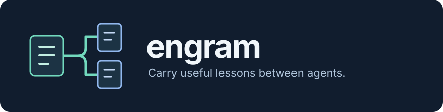

<p align="center">
  
</p>

# Engram

Carry useful lessons between Claude Code and Codex. Engram keeps a shared store
of Markdown memories and writes them into each agent's native memory location,
so switching agents doesn't have to mean explaining the same lesson again.

For example, you discover that a project's integration tests need a local test
server. Keep that lesson scoped to the project, reconcile it with Engram, and it
can reach the other agent's memory too. A personal preference can apply across
projects; a machine-specific lesson can stay on the machines that need it.

Engram is for developers who use both agents, return to projects across sessions,
or want their retained lessons in a store they can inspect, edit, and version.
It shares deliberately retained memory, not full conversations or an exact
checkpoint of unfinished work. Your agent still decides what is useful and when
to use it.

**Working, pre-1.0.** Supports Claude Code and Codex. Commands and memory formats
may change before 1.0; see the [CLI contract](docs/cli.md) and
[release history](CHANGELOG.md).

## Start with your agent

Open your coding agent in a project and paste:

```text
Help me get started with Engram: https://github.com/davisbuilds/engram

Read its README and operating guide. Check the prerequisites, existing Engram
configuration, and the actual memory homes of the agents I use. Preserve my
existing memories and settings. Explain where Engram will read and write, and
help me choose which harnesses to enable before applying changes.

Build it using the documented source installation. Try one synthetic memory in
the disposable setup from the operating guide, then help me retain one useful
lesson from my own work at the narrowest appropriate scope. Preview propagation,
inspect the written memory, and check whether my agent actually reads it.

Set up hooks, scheduling, or agent-driven curation only if I ask.
```

Prefer the terminal? Follow the steps below. To try Engram without writing to
your agents' memory, use the [disposable walkthrough](docs/operating.md#try-it-without-touching-your-agents).

## Install from source

You need **Git, Make, and Go 1.27.3 or later**, on macOS or Linux with a local
filesystem. Windows is not supported by the current Unix file-locking code.
Use a Claude Code or Codex installation with native memory support to consume
the results. Engram's releases currently publish tags and notes, without
prebuilt binaries or packages.

```bash
git clone https://github.com/davisbuilds/engram.git
cd engram
make build
./bin/engram version
```

Run the examples from this checkout. No API key or headless agent is needed for
the commands below. Only `curate` launches an agent.

### Check where it will write

```bash
./bin/engram config --json
```

With no configuration, the canonical store is `~/.engram/canonical`, and **both
harnesses are enabled**, using `~/.claude` and `~/.codex`. Engram can create those
directories even if an agent is absent. Before continuing, check that these are
the right homes. If you use only one agent or a custom home, first follow
[configuration and readiness](docs/operating.md#configuration-and-readiness).

Read each harness's warnings as well as `ready`: this is a filesystem/settings
check, not proof that an agent consumed a memory. Claude's shared index may need
read permission; Codex needs its native memory feature to consume extension
notes. The operating guide explains both.

## Remember one thing

Try this example preference, or replace it with a lesson you want to retain:

```bash
./bin/engram remember --name explain-check-results --type preference --scope global \
  --description "Explain what was checked and what the result means" \
  --body "When reporting a completed change, name the check you ran, its result, and any remaining uncertainty." --json
./bin/engram sync --json
```

`remember` **writes immediately** to the canonical store; `sync` previews the
files it would create or update. Inspect that preview, then apply it:

```bash
./bin/engram sync --apply --json
./bin/engram show claude-code --json
./bin/engram show codex --json
```

For each enabled harness, `show` should include `explain-check-results` and the
path Engram wrote. Open the file to check the text. Run `sync --json` again: it
should report no pending actions for unchanged inputs.

Then start a fresh agent session and ask it to find this preference, name the
memory file it read, and use it when reporting a small check. **A rendered file
proves delivery; the agent's behavior is the next check.** Codex folds extension
notes through its own memory consolidation, so a successful sync doesn't promise
immediate availability in a session.

To remove this example, preview `./bin/engram forget explain-check-results --json`,
then rerun it with `--apply`. This retires the canonical memory and removes its
Engram-owned renders; it does not erase text already folded into a harness's
own consolidated memory.

## Use it in everyday work

Once you've checked the configuration, you can optionally install the command
on your PATH with `make install` (default `~/.local/bin`; override `PREFIX`).
The examples here keep using the checkout's binary.

**Bring lessons across agents.** Preview a reconciliation, inspect the import
outcomes and render actions, then apply:

```bash
./bin/engram reconcile --json
./bin/engram reconcile --apply --json
```

Inspect native entries, managed renders and canonical coverage without writing:

```bash
./bin/engram status --all-projects --json
```

Counts distinguish physical entries from normalized names; incomplete sources and
reasons for missing canonical entries are explicit. This inventories stored
memories, not whether a session consumed them. See the [CLI contract](docs/cli.md).

Reconcile imports native memories from enabled harnesses, reports review leads,
and propagates canonical memories without echoing them onto their native source.
It sweeps all Claude project memory directories, not just the current project.
It never runs curation. These examples target this checkout's directory; add
`--cwd /absolute/path/to/project` to target another project. See [adopting existing memory](docs/operating.md#adopt-existing-memories)
before your first real import.

**Keep a project lesson in its project.** Ask your agent:

```text
Use Engram to retain the integration-test server requirement we just verified.
Read the existing memories first. Scope it to this repository and its working
directory, preserve the evidence needed to check it later, and preview its
propagation before applying. Don't copy procedures already maintained in our docs.
```

Scopes are `global` or `project:<repo-name>`, with optional directory, agent,
and host filters. Widening scope is explicit: `share` writes immediately.
[Operating guidance](docs/operating.md#scope-a-memory) shows a concrete example.

**Keep memory useful.** Run `./bin/engram review --json` for near-duplicate-name
leads. Your agent can compare the text and decide what to merge or retire.
For agent-proposed batches, use the [reviewed curation plan workflow](docs/headless.md#reviewed-plans):
save a proposal, review it, then apply that exact file. Curation is optional and
uses the selected agent's authentication and provider.

**Use more than one machine.** Choose one writer for the canonical store; other
machines pull its Git history and render with `sync --apply`. Engram does not
transport files or coordinate writers across machines. See
[multi-machine operation](docs/operating.md#more-than-one-machine).

## Your data and control

- **Storage.** Canonical memories are Markdown with YAML frontmatter. Engram
  doesn't initialize Git, commit, back up, or upload the store for you. Keep
  sensitive lessons in a private location and follow the
  [versioning guide](docs/operating.md#versioning-the-canonical-store).
- **What it reads and writes.** Imports read Claude project memory files and
  Codex's consolidated `memories/MEMORY.md`, not entire conversation histories.
  Sync writes marked files and index entries under the configured harness homes.
  The [location map](docs/operating.md#where-memories-live) shows the paths.
- **Existing files.** Ordinary sync never overwrites or deletes unmarked files.
  Conflicts need a decision. The explicit `migrate --apply` command is the
  exception: it can adopt or retire a Claude original only when canonical
  provably supersedes it. Preview it first.
- **Writes.** `remember` and `share` write immediately. Sync, import, reconcile,
  migration, retirement, and curation apply only with `--apply`; a dry-run
  `curate` still launches an agent, and `--save-plan` writes a proposal file.
- **Network and agents.** Engram itself has no network client or background
  daemon. `curate` passes the canonical corpus and review findings to a headless
  agent, even in a dry run; that agent may send them to its provider. Rendered
  memories can also become context in your normal agent sessions. Keep secrets
  out of memory.

## If something looks wrong

| What you see | Next step |
| --- | --- |
| A memory was written but the agent doesn't use it | Inspect `config --json` warnings, the actual harness home and memory settings, then verify consumption in a fresh session. See [readiness](docs/operating.md#configuration-and-readiness). |
| `CONFLICT` or exit `3` | Read the named source and canonical files. Import can explicitly keep canonical or refresh from native; don't force an overwrite to make a check green. See [adoption](docs/operating.md#adopt-existing-memories). |
| A memory is missing in another project | Check scope and directory/agent/host filters with `list --json` from that project. Host filters require configured host labels. |
| `locked` | Another Engram operation holds the lock. Let it finish and retry; deleting the lock file is not recovery. |
| A command prints JSON in a pipe | That's the default for non-TTY output. Use `--plain` for text or `--json` to make structured output explicit. |

## Go further

- [Operating guide](docs/operating.md): configuration, a disposable trial, adoption, scope, backups, and multiple machines.
- [CLI reference](docs/cli.md): all commands, JSON schemas, exit codes, and conflict semantics.
- [Agent workflows](docs/headless.md): capture, review, saved curation plans, and optional hook wiring.
- [Vision](docs/project/VISION.md): intended outcomes and memory's relationship to instructions, docs, and handoffs.

## Work on Engram

Focused fixes and documentation improvements are welcome. Start with
[Contributing](CONTRIBUTING.md) and the [build and test checks](AGENTS.md#build--test).
[AGENTS](AGENTS.md#architecture-load-bearing-invariants) explains the architecture
and source boundaries; [Backlog](docs/project/BACKLOG.md) holds future work.
[Release operations](docs/releases.md) covers version policy and publishing.

## License

[MIT](LICENSE).
